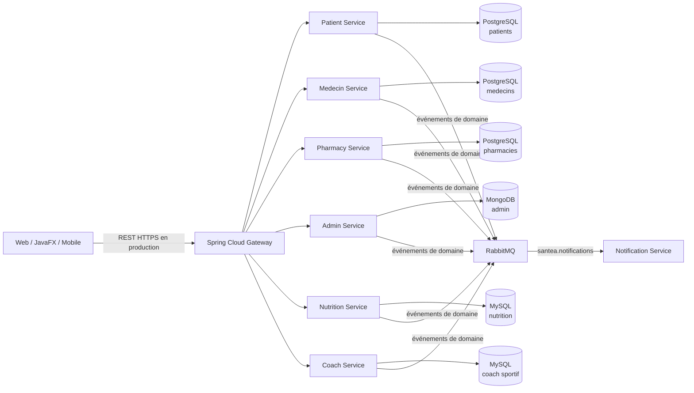

# SANTÉA - Microservices Spring Boot

Projet séparé de l'application Symfony/JavaFX existante. Il reprend ses domaines
Patient, Médecin, Pharmacie, Administration, Nutritionniste et Coach sportif,
avec un microservice CRUD autonome pour chacun. Le service pharmacie inclut
aussi le profil `Pharmacien` lié aux pharmacies.

## Architecture

Les modules du backend (services, Gateway et bibliothèques communes) sont regroupés dans `Backend/`.



Les services ne partagent pas leurs tables. Chaque service possède sa base, même
si plusieurs bases utilisent le même moteur. Les échanges synchrones passent
par REST; les changements métier sont aussi publiés sur l'échange RabbitMQ
`santea.domain.events`. La file durable `santea.notifications` reçoit tous les
événements. Le service de notification fourni ne fait que les journaliser : il
sert de consommateur de démonstration et n'envoie pas encore d'e-mail/SMS.

| Service | Domaine | Stockage |
|---|---|---|
| `patient-service` | Profil patient | PostgreSQL, base `santea_patients` |
| `medecin-service` | Profil médecin | PostgreSQL, base `santea_medecins` |
| `pharmacy-service` | Pharmacie | PostgreSQL, base `santea_pharmacies` |
| `admin-service` | Compte `User` avec le rôle `ROLE_ADMIN` | MongoDB, base `santea_admin` |
| `nutrition-service` | Nutritionniste | MySQL, base `santea_nutrition` |
| `coach-service` | Coach sportif | MySQL, base `santea_coach` |

## Modèles repris de Symfony

Les nouveaux modèles suivent les propriétés persistées des entités Symfony
`User`, `Patient`, `Medecin`, `Pharmacien`, `Pharmacy`, `Nutritionniste` et
`CoachSportif`. Les champs du `User` sont dans l'objet JSON `user` des profils
patient, médecin, pharmacien, nutritionniste et coach; l'admin expose directement
les champs de `User` avec le rôle `ROLE_ADMIN`.

Champs du compte `User` repris :
`username`, `email`, `password`, `nom`, `prenom`, `dateNaissance`, `adresse`,
`telephone`, `role`, `emailVerified`, `adminApproved`, `mfaEnabled`,
`googleAuthenticatorSecret`, `themePreference`, `locale`, `avatarData`,
`avatarMime`, `reminderEnabled`, `emailVerificationToken`,
`emailVerificationExpiresAt`, `subscriptionStatus`, `subscriptionType`,
`subscriptionEndAt`, `aiFreeMonthGrantedAt`, `isBanned`, `banReason`, `banUntil`,
`deletedAt`, `createdAt`, `updatedAt`, ainsi que les relations `patient`,
`medecin`, `pharmacien`, `coachSportif`, `nutritionniste`, `googleFitAccount`,
`contenus`, `likes`, `commentaires`, `reponsesMedicaments`, `notifications` et
`santeQuotidiennes`. Les relations sont transmises comme identifiants (`...Id`
ou listes d'identifiants) pour ne pas créer de clés étrangères entre services.

Champs métier repris :

- Patient : `numeroSecu`, `groupeSanguin`, `allergies`, `antecedentsMedicaux`,
  `createdAt`, `updatedAt`, `rendezVous`, `rapportsAnalyses`, `rapportsMedicaux`,
  `journalItems`, `symptomesQuotidiens`, `plansExercices`, `plansRegimes`.
- Médecin : `specialite`, `numeroOrdre`, `cabinetAdresse`, `cabinetVille`,
  `cabinetLat`, `cabinetLng`, `telephoneCabinet`, `tarifConsultation`,
  `createdAt`, `updatedAt`, `disponibilites`, `rendezVous`, `rapportsAnalyses`,
  `rapportsMedicaux`.
- Pharmacien : `numeroOrdre`, `pharmacieNom`, `pharmacieAdresse`, `createdAt`,
  `updatedAt`, `pharmacies`.
- Pharmacy : `nom`, `adresse`, `telephone`, `email`, `horaires`, `latitude`,
  `longitude`, `isActive`, `imageName`, `createdAt`, `updatedAt`, `stocks`.
- Nutritionniste et coach sportif : `specialite`, `justificatif`, `createdAt`.

Les associations Doctrine vers les autres entités sont représentées par leurs
identifiants, pas par des objets JPA partagés. Les identifiants SQL sont des
nombres entiers (Java `Long`); MongoDB utilise un compteur atomique afin que
l'identifiant admin soit également numérique. Il s'agit des mêmes attributs
métier, pas d'une migration de la base Symfony ni d'une copie identique de ses
contraintes physiques.

## Démarrage local

Prérequis : Docker avec le plugin Compose. À la racine du dépôt :

```powershell
$env:SANTEA_SECURITY_JWT_SECRET = [Convert]::ToBase64String([Security.Cryptography.RandomNumberGenerator]::GetBytes(32))
$env:ADMIN_BOOTSTRAP_USERNAME = "admin"
$env:ADMIN_BOOTSTRAP_EMAIL = "admin@example.test"
$env:ADMIN_BOOTSTRAP_PASSWORD = Read-Host "Mot de passe initial de l'administrateur"
docker compose up --build
```

Le Gateway écoute sur `http://localhost:8088` (port local distinct de son port interne 8080).
L'interface RabbitMQ de
démonstration est sur `http://localhost:15672` (identifiants locaux `santea` /
`santea_dev`). Les ports des bases sont publiés uniquement sur `127.0.0.1`.
Le mot de passe de bootstrap ne sert qu'à créer le premier administrateur dans
une base admin vide. Ensuite, les administrateurs se connectent avec leur
identifiant (nom d'utilisateur ou e-mail) et leur mot de passe.

Arrêt sans supprimer les données :

```powershell
docker compose down
```

Les identifiants du Compose sont des valeurs de développement seulement. Les
remplacer par des secrets gérés hors du dépôt avant tout déploiement.

### Gestion centralisée des utilisateurs

L'interface Swagger est disponible à
[`http://localhost:8088/swagger-ui/index.html`](http://localhost:8088/swagger-ui/index.html).
Dans Swagger, utilise `POST /api/v1/auth/login` avec l'identifiant et le mot de
passe de l'administrateur, puis copie `accessToken`. Clique sur **Authorize**,
colle le jeton et valide pour accéder aux opérations protégées.

Toutes les routes API, y compris les routes métier, exigent un jeton JWT
d'administrateur. Pour obtenir un jeton depuis PowerShell :

```powershell
$login = Invoke-RestMethod -Method Post -Uri http://localhost:8088/api/v1/auth/login `
  -ContentType "application/json" `
  -Body (@{ identifier = "admin"; password = $env:ADMIN_BOOTSTRAP_PASSWORD } | ConvertTo-Json)
$headers = @{ Authorization = "Bearer $($login.accessToken)" }
```

Le jeton donne accès à l'API centralisée :

| Action | Méthode et route |
|---|---|
| Lister les comptes | `GET /api/v1/users` |
| Rechercher/filtrer | `GET /api/v1/users?q=amira&type=patient&active=true` |
| Consulter un compte | `GET /api/v1/users/{type}/{id}` |
| Créer un profil | `POST /api/v1/users/{type}` |
| Modifier les informations du compte ou son état | `PATCH /api/v1/users/{type}/{id}` |
| Supprimer le profil | `DELETE /api/v1/users/{type}/{id}` |

Les types disponibles sont `patient`, `medecin`, `pharmacien`, `nutritionniste`,
`coach-sportif` et `admin`. Les créations utilisent le corps JSON du service
métier correspondant. Par exemple, pour désactiver le patient `1` :

```powershell
Invoke-RestMethod -Method Patch -Uri http://localhost:8088/api/v1/users/patient/1 `
  -Headers $headers -ContentType "application/json" -Body '{"active":false}'
```

L'API centrale rassemble les comptes sans déplacer leurs profils métier. Le
rôle est fixé par le type de profil (`ROLE_PATIENT`, `ROLE_MEDECIN`, etc.) et
ne peut pas être changé en un autre type depuis l'administration centrale.
Les modifications des données spécifiques (cabinet, allergies, spécialité...)
restent sur les routes métier correspondantes. Le dernier administrateur actif
ne peut pas être désactivé ni supprimé.

## Contrat REST v1

Toutes les routes publiques passent par le Gateway et commencent par
`/api/v1`. Les exemples de création et de mise à jour utilisent JSON.

| Ressource | Route |
|---|---|
| Patients | `/api/v1/patients` |
| Médecins | `/api/v1/medecins` |
| Pharmacies | `/api/v1/pharmacies` |
| Pharmaciens | `/api/v1/pharmaciens` |
| Utilisateurs admin | `/api/v1/admin-users` |
| Nutritionnistes | `/api/v1/nutritionnistes` |
| Coaches sportifs | `/api/v1/sports-coaches` |

Chaque ressource expose les mêmes opérations :

| Méthode | Route | Réponse nominale |
|---|---|---|
| `POST` | `/api/v1/{collection}` | `201 Created`, ressource créée et en-tête `Location` |
| `GET` | `/api/v1/{collection}` | `200 OK`, tableau des ressources |
| `GET` | `/api/v1/{collection}/{id}` | `200 OK`, ressource; `404` si absente |
| `PUT` | `/api/v1/{collection}/{id}` | `200 OK`, ressource remplacée; `400` si invalide; `404` si absente |
| `DELETE` | `/api/v1/{collection}/{id}` | `204 No Content`; `404` si absente |

`PUT` remplace tous les champs modifiables. Les identifiants métier sont des
nombres entiers, comme les identifiants Symfony.
Les champs requis et les adresses e-mail sont validés; les erreurs de validation
retournent `400 Bad Request`. `POST`, `GET` et `PUT` retournent l'objet JSON
complet avec son identifiant généré; les listes retournent un tableau JSON.
Les dates utilisent le format ISO (`dateNaissance` est une date sans heure) et les
montants sont des nombres décimaux.

### Champs et exemples de corps

`POST /api/v1/patients`

```json
{
  "userId": 42,
  "user": {
    "username": "amira.ben.salem",
    "email": "amira@example.test",
    "password": "mot-de-passe-a-remplacer",
    "nom": "Ben Salem",
    "prenom": "Amira",
    "dateNaissance": "1994-04-15",
    "adresse": "Tunis",
    "telephone": "+21600000000",
    "role": "ROLE_PATIENT"
  },
  "numeroSecu": "SEC-12345",
  "groupeSanguin": "A+",
  "allergies": "Aucune connue",
  "antecedentsMedicaux": "Aucun connu",
  "rendezVous": [],
  "rapportsAnalyses": [],
  "rapportsMedicaux": [],
  "journalItems": [],
  "symptomesQuotidiens": [],
  "plansExercices": [],
  "plansRegimes": []
}
```

Les champs communs du compte `User` omis dans cet exemple restent disponibles
dans l'objet `user`. `password` est haché par BCrypt avant stockage et n'est
jamais renvoyé. `googleAuthenticatorSecret` et `emailVerificationToken` sont
conservés dans le modèle mais exclus de l'API CRUD générique.

`POST /api/v1/medecins`: objet `user` et `userId`, puis
`specialite`, `numeroOrdre`, `cabinetAdresse`, `cabinetVille`, `cabinetLat`,
`cabinetLng`, `telephoneCabinet`, `tarifConsultation`, `disponibilites`,
`rendezVous`, `rapportsAnalyses`, `rapportsMedicaux`.

`POST /api/v1/pharmaciens`: objet `user` et `userId`, puis `numeroOrdre`,
`pharmacieNom`, `pharmacieAdresse`, `pharmacies`.

`POST /api/v1/pharmacies`: `pharmacienId`, `nom`, `adresse`, `telephone`,
`email`, `horaires`, `latitude`, `longitude`, `isActive`, `imageName`, `stocks`.

`POST /api/v1/admin-users`: tous les attributs du compte `User` directement à
la racine; le rôle est fixé à `ROLE_ADMIN`.

`POST /api/v1/nutritionnistes` et `/api/v1/sports-coaches`: objet `user` et
`userId`, puis `specialite`, `justificatif`.

### Événements RabbitMQ

Après les commandes CRUD, les services publient les clés de routage suivantes :

- `{patient|medecin|pharmacy|pharmacien|admin-user|nutritionniste|sports-coach}.created.v1`
- `{patient|medecin|pharmacy|pharmacien|admin-user|nutritionniste|sports-coach}.updated.v1`
- `{patient|medecin|pharmacy|pharmacien|admin-user|nutritionniste|sports-coach}.deleted.v1`

Enveloppe JSON :

```json
{
  "eventId": "c1ff3639-154d-43e8-a470-f61b18f280f1",
  "eventType": "patient.created.v1",
  "occurredAt": "2026-11-09T18:30:00Z",
  "aggregateId": "42",
  "payload": {
    "patientId": 42
  }
}
```

Les consommateurs doivent être idempotents. Pour fiabiliser la publication entre
la transaction SQL et RabbitMQ en production, remplacer la publication directe
par un transactional outbox.

## Limites de cette base de départ

- CRUD de démonstration; le `DELETE` est physique.
- Aucune authentification/autorisation n'est configurée. Avant de traiter des
  données de santé, ajouter OIDC/JWT, TLS, autorisations par rôle et audit.
- `ddl-auto: update` est pratique en développement; utiliser des migrations
  versionnées (Flyway/Liquibase) avant production.
- Les données personnelles de santé sont sensibles : ne pas utiliser les
  exemples ou identifiants locaux en production.
