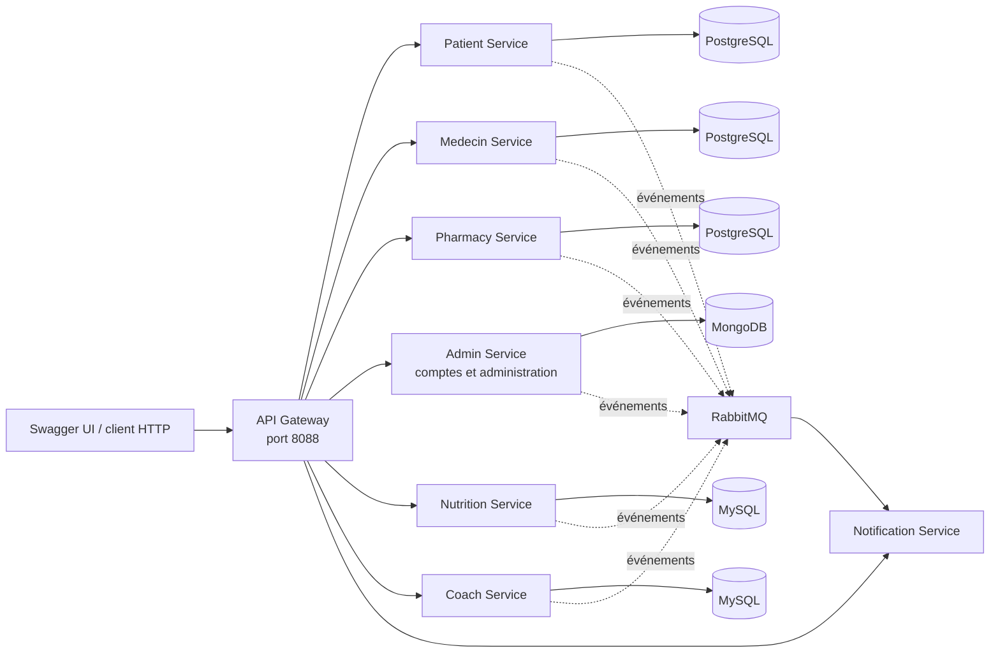

# SANTEA — Backend Spring Boot

Backend composé de microservices Spring Boot. Les profils et leurs données métier restent séparés par service; les appels passent par une API Gateway.

## Architecture du dépôt

```text
SANTEA/
├── Backend/
│   ├── api-gateway/          # Point d'entrée des API
│   ├── admin-service/        # Administration et répertoire central des comptes
│   ├── patient-service/
│   ├── medecin-service/
│   ├── pharmacy-service/     # Pharmacies et pharmaciens
│   ├── nutrition-service/
│   ├── coach-service/
│   ├── notification-service/
│   ├── common-model/         # Modèles partagés
│   ├── common-events/        # Événements RabbitMQ partagés
│   └── common-security/      # Sécurité JWT partagée
├── Documentation/            # Documentation du projet
├── Frontend/                 # Dossier réservé à l'interface
├── docker-compose.yml        # Services, bases et infrastructure locale
├── Dockerfile                # Image des microservices Spring Boot
└── pom.xml                   # Agrégateur Maven
```

Le dossier `Frontend/` est actuellement réservé à l'interface; le client décrit ici est Swagger UI.

## Architecture technique



| Service | Responsabilité | Base |
|---|---|---|
| `api-gateway` | Point d’entrée HTTP et routage des API | — |
| `patient-service` | Profils patients | PostgreSQL |
| `medecin-service` | Profils médecins | PostgreSQL |
| `pharmacy-service` | Pharmacies et pharmaciens | PostgreSQL |
| `nutrition-service` | Profils nutritionnistes | MySQL |
| `coach-service` | Profils coachs sportifs | MySQL |
| `admin-service` | Comptes administrateurs et gestion centralisée | MongoDB |
| `notification-service` | Consommation des événements | RabbitMQ |

### Modules Maven partagés

| Module | Rôle |
|---|---|
| `common-model` | Modèle de compte commun, validation et hachage BCrypt |
| `common-events` | Publication et configuration des événements RabbitMQ |
| `common-security` | Configuration Spring Security et validation des jetons JWT |

## Technologies et dépendances

- **Langage et build :** Java 17 et Maven; versions gérées par le POM racine.
- **Framework :** Spring Boot 3.4.4 et Spring Cloud 2024.0.1.
- **API :** Spring Web, Spring Cloud Gateway, validation Jakarta et JSON.
- **Sécurité :** Spring Security, OAuth2 Resource Server et JWT; mots de passe hachés avec BCrypt.
- **Persistance :** Spring Data JPA avec PostgreSQL/MySQL; Spring Data MongoDB pour l'administration.
- **Messagerie :** Spring AMQP et RabbitMQ.
- **Documentation API :** Springdoc OpenAPI / Swagger UI.
- **Outils :** Lombok, Docker et Docker Compose.

### Dépendances par module

| Module | Dépendances principales |
|---|---|
| `api-gateway` | Spring Cloud Gateway, Spring Boot Actuator |
| `admin-service` | Spring Web, Validation, Spring Data MongoDB, Springdoc OpenAPI |
| `patient-service`, `medecin-service`, `pharmacy-service` | Spring Web, Spring Data JPA, Validation, pilote PostgreSQL |
| `nutrition-service`, `coach-service` | Spring Web, Spring Data JPA, Validation, pilote MySQL |
| `notification-service` | Spring Boot, Spring AMQP, `common-events` |
| Services métier | `common-model`, `common-events`, `common-security` |
| `common-model` | API JPA et Validation, annotations Jackson, BCrypt |
| `common-events` | Spring AMQP et support JSON |
| `common-security` | Spring Security et OAuth2 Resource Server |

## Démarrage local

Prérequis : Docker Desktop avec le moteur Linux démarré.

Dans PowerShell, à la racine du projet, crée une clé JWT et les identifiants du premier administrateur :

```powershell
$bytes = New-Object byte[] 32
$rng = [Security.Cryptography.RandomNumberGenerator]::Create()
$rng.GetBytes($bytes)
$env:SANTEA_SECURITY_JWT_SECRET = [Convert]::ToBase64String($bytes)
$rng.Dispose()

$env:ADMIN_BOOTSTRAP_USERNAME = "admin"
$env:ADMIN_BOOTSTRAP_EMAIL = "admin@local.test"
$env:ADMIN_BOOTSTRAP_PASSWORD = Read-Host "Mot de passe administrateur"
```

Démarre les services :

```powershell
docker compose up -d --build
```

Swagger UI : [http://localhost:8088/swagger-ui/index.html](http://localhost:8088/swagger-ui/index.html)

Dans Swagger, utilise `POST /api/v1/auth/login` pour te connecter, puis clique sur **Authorize** et colle le `accessToken`. Les opérations d’administration permettent ensuite de lister, rechercher et gérer les comptes via `/api/v1/users`.

Les variables définies dans PowerShell sont nécessaires pour chaque nouvelle session. Pour arrêter les services sans effacer les données :

```powershell
docker compose down
```

Les mots de passe et ports configurés dans Docker Compose sont prévus pour le développement local seulement.
